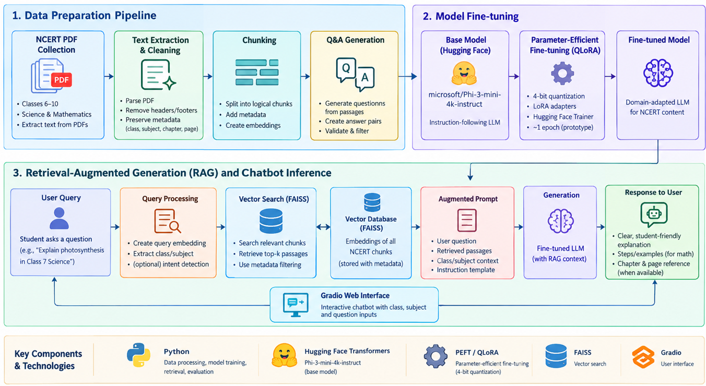
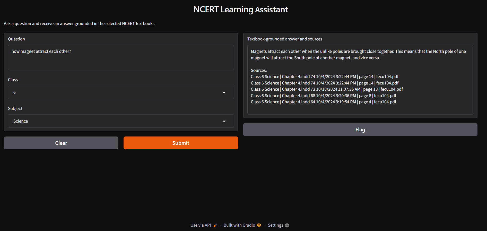

# NCERT Learning Assistant : A Domain-Specific Large Language Model for School-Level Science and Mathematics Question Answering

Submitted by - Mohammad Mamoor Ahmad

GitHub Link-https://github.com/mamoor2019/LLMBot

## 1. Project Overview

The NCERT Learning Assistant is an AI-powered educational chatbot designed to help students understand school-level Science and Mathematics concepts using NCERT textbooks as the primary knowledge source.

Students frequently need additional explanations, examples, and step-by-step solutions while studying textbook chapters. Although general-purpose large language models (LLMs) can answer many questions, their responses may not always align with the prescribed curriculum, use language appropriate to the student's grade, or remain grounded in the relevant textbook.

This project addresses these challenges by developing an educational assistant using a pretrained LLM, textbook-based retrieval, and parameter-efficient fine-tuning. The system retrieves relevant textbook content, generates student-friendly answers, and provides chapter and page references when source metadata is available.

The initial scope focuses on NCERT Science and Mathematics for Classes 6–10. The architecture can later be extended to Classes 11–12 and additional subjects.

## 2. Problem Statement

Students may struggle to understand scientific concepts, mathematical procedures, definitions, and textbook exercises. Traditional textbooks provide prescribed material but do not interactively respond to individual doubts.

General-purpose AI chatbots offer interactive explanations, but they may introduce information outside the curriculum, generate incorrect mathematical solutions, or provide explanations that are too advanced for the student's class level.

The objective is to develop an interactive educational chatbot that combines the language-generation capabilities of a pretrained LLM with factual grounding from NCERT textbook content. The project investigates whether domain-specific fine-tuning and retrieval improve the correctness, relevance, and educational usefulness of generated answers.

## 3. Objectives

- Collect NCERT Science and Mathematics textbooks in PDF format.
- Extract and preprocess textbook content while preserving class, subject, chapter, and page metadata.
- Divide extracted content into useful text chunks for retrieval and language-model processing.
- Generate a question-and-answer dataset from textbook passages.
- Select an instruction-following LLM that can be adapted within available GPU memory.
- Fine-tune the selected model using parameter-efficient techniques such as LoRA or QLoRA.
- Implement retrieval-augmented generation (RAG) to find relevant NCERT content for student questions.
- Develop an interactive chatbot interface.
- Test the system with representative Science and Mathematics questions.
- Compare model configurations using a consistent evaluation dataset.

## 4. Technology Stack

| Area | Technology | Purpose |
| --- | --- | --- |
| Language | Python | Data processing, model inference, training, retrieval, and evaluation |
| Runtime and storage | Google Colab, Google Drive, CUDA GPU (T4 target) | Notebook execution, PDF access, and GPU acceleration |
| Deep learning | PyTorch | Model execution and tensor operations |
| Language model | Hugging Face Transformers; `microsoft/Phi-3-mini-4k-instruct` | Base instruction-following model and text generation |
| Fine-tuning | PEFT, QLoRA, bitsandbytes, Accelerate | 4-bit quantization and low-rank adapter training |
| Dataset and preprocessing | Hugging Face Datasets, pandas, NumPy, pypdf | PDF extraction, structured records, and chat-format datasets |
| Data splitting | scikit-learn `GroupShuffleSplit` | Train, validation, and test splits grouped by source document |
| Embeddings | Sentence Transformers; `sentence-transformers/all-MiniLM-L6-v2` | Text and query embeddings for semantic search |
| Vector search | FAISS (`faiss-cpu`) | Similarity search over textbook chunks |
| User interface | Gradio | Interactive question, class, and subject inputs with answer output |
| Evaluation | Custom token-level F1 using Python, pandas, and NumPy | Preliminary lexical-overlap comparison of model outputs |


## 5. Architecture Overview
The architectural overview is shown in this architecture diagram.



## 6. Runtime and Dependencies

The notebook is designed for Google Colab. Its setup cell installs Transformers (`>=4.45,<5`), Hugging Face Hub (`>=0.34,<1`), Datasets (`>=4,<5`), PEFT (`>=0.13`), bitsandbytes (`>=0.44`), Accelerate, Sentence Transformers, FAISS CPU, Gradio, pypdf, scikit-learn, and pandas (`2.2.3`). PyTorch is used for model execution and training.

The notebook mounts Google Drive and requires a CUDA-enabled GPU for Phi-3 loading, QA generation, and QLoRA training. A Colab T4 is the target runtime. After installing dependencies, restart the runtime before running imports or loading the model. Execute cells in order so that data, model, splits, and index are initialized before downstream cells use them.

## 7. Data Collection and Organization

Textbooks are supplied as PDF files by the project user; the notebook does not download them. The project dataset uses class and subject directories, for example:

```text
DataSet/
  ncert/
    class_6/
      Mathematics/
      Science/
    class_7/
      Mathematics/
      Science/
    ...
    class_10/
      Mathematics/
      Science/
```

The notebook mounts Google Drive and searches for `LLMBot/DataSEt`, matching folder names without regard to capitalization, then falls back to `/content/drive/MyDrive/LLMBot/DataSEt`. PDF discovery is recursive, so class folders may be nested under `ncert`. Keep the folder structure consistent with the configured data root.

PDF discovery is limited to `class_6` through `class_10`; missing grades are skipped. The class folder and following subject folder provide metadata. Each extracted page retains its source PDF, class, subject, one-based page number, detected chapter, and a document ID derived from the relative PDF path.

## 8. PDF Processing and Chunking

The notebook uses pypdf to extract text page by page. It removes null and soft-hyphen characters, joins words split by line-break hyphenation, normalizes spacing, and reduces excessive blank lines. Chapter and lesson headings are detected with a regular expression; when a page has no new heading, the previous chapter label is carried forward.

Empty pages are reported for review. Scanned pages without an embedded text layer are not OCR-processed. Each page is divided into chunks of 1,200 characters with 200 characters of overlap. Chunks shorter than 80 characters are dropped. Page and document metadata is copied to each chunk so retrieval results can be traced back to their source.

## 9. Base Model Selection

The selected base model is `microsoft/Phi-3-mini-4k-instruct`. It is an instruction-tuned model used both to create training examples and to answer user questions. The notebook loads it in 4-bit NF4 with double quantization and automatic device placement to reduce GPU memory requirements. The tokenizer's pad token is set to its end-of-sequence token when necessary.

Phi-3 Mini is the selected model for this project. Generation is deterministic (`do_sample=False`) and uses a maximum of 256 new tokens by default. 

## 10. Training Data Generation

For each sampled chunk, the base model is prompted to produce one clear, school-level question and a concise answer using only that passage. The response must contain a JSON object with `question` and `answer` fields. Malformed JSON or empty fields are rejected. Accepted examples retain the instruction, passage, question, answer, class, subject, chapter, source PDF, document ID, page, and chunk ID.

The current limit is `QA_SAMPLE_LIMIT = 20`. Chunks are sampled approximately evenly across available class-and-subject groups, using seed 42. Progress is checkpointed every five candidates in `artifacts/ncert_qa_checkpoint.jsonl`; accepted examples are written to `artifacts/ncert_qa.jsonl`. At least three valid examples are required to proceed. Review generated questions and answers before increasing the pilot limit, since generated data can contain factual or formatting errors.
## 11. Semantic Validation Samples

The notebook runs retrieval spot checks using representative questions across classes and subjects. The table summarizes the saved output; similarity scores are retrieval-ranking values, not accuracy percentages.

| Class and subject | Sample query | Retrieved passages |
| --- | --- | --- |
| Class 6 Mathematics | “fractions and equivalent fractions” | Chapter 7: Fractions, page 36 (0.626); page 22 (0.554); page 31 (0.550) |
| Class 6 Mathematics | “What are equivalent fractions?” | Chapter 7: Fractions, page 36 (0.714); page 22 (0.576) |
| Class 7 Science | “How do plants transport water?” | Chapter 10: Transport in Plants, page 11 (0.720); page 12 (0.638) |
| Class 8 Mathematics | “How do linear equations work?” | Chapter metadata returned as `Unknown`, page 1 (0.383); page 15 (0.373) |

The Class 8 result shows that semantic matches can still have incomplete chapter metadata; inspect the source passage and citation before relying on a result.

## 12. Leakage-Resistant Data Splits

Examples are split by source PDF using scikit-learn's `GroupShuffleSplit`, with `document_id` as the group. The initial split reserves 20% of documents as a holdout; the holdout is divided equally into validation and test groups. This yields approximately 80%/10%/10% of documents, not necessarily the same proportions of examples. The code requires at least six distinct source documents and checks that the splits are non-empty and share no document IDs.

Each example is formatted using the Phi-3 chat template and saved as JSON Lines:

- `artifacts/train.jsonl`
- `artifacts/validation.jsonl`
- `artifacts/test.jsonl`

The test split is reserved for the final model comparison.

## 13. QLoRA Fine-Tuning

QLoRA adapts the 4-bit base model with trainable low-rank adapters. Before training, the model is prepared for k-bit training, gradient checkpointing is enabled, and the cache is disabled. The LoRA configuration is:

- Rank: 16
- Alpha: 32
- Dropout: 0.05
- Bias: none
- Target modules: `qkv_proj`, `o_proj`, `gate_up_proj`, and `down_proj`

Training runs for one epoch with per-device batch size 1, gradient accumulation of 8, learning rate `2e-4`, FP16, gradient checkpointing, and the 8-bit paged AdamW optimizer. Validation runs at each epoch. The adapter and tokenizer are saved under `artifacts/phi3-qlora-adapter/`; Trainer checkpoints are written under `artifacts/phi3-qlora/`.


## 14. Retrieval-Augmented Generation

The retrieval pipeline uses `sentence-transformers/all-MiniLM-L6-v2` to embed all textbook chunks. It normalizes the vectors and stores them in a FAISS `IndexFlatIP` index, allowing inner-product search over normalized embeddings. At query time, the notebook embeds the question, searches the index, filters results by optional class and subject, and returns up to five chunks.

The retrieved passages and their class, subject, chapter, and page metadata are placed in the answer prompt. The prompt tells the model to use only the supplied textbook context and to say when the context does not support an answer. The interface adds chapter, page, and source filename citations when passages are retrieved.

The index and metadata are saved as:

- `artifacts/faiss_ncert/index.faiss`
- `artifacts/faiss_ncert/metadata.jsonl`


## 15. Application Interface and Results

A Gradio interface accepts a question, class, and subject. The default class is 6 and the subject selector includes an all-subjects option. After submission, the generated answer and textbook citations appear in the interface's output textbox. 

**Where to view results:** Run the launch cell and open the Gradio URL shown in its output. Submit a question in the UI to see the answer and citations. Interactive UI responses are not saved automatically. The evaluation cell displays the model-comparison table, and the metrics are written to `artifacts/evaluation_results.csv` under `OUTPUT_ROOT` (`Path.cwd() / "artifacts"`). In Colab, files in the runtime working directory may be temporary unless copied to persistent storage such as Google Drive.



## 16. Testing and Evaluation

The project defines the following development checks:

- Confirms PDF text was extracted and reports pages without text.
- Displays sample page records and chunk examples for inspection.
- Validates that enough QA records and source documents exist to create splits.
- Asserts that source document IDs do not overlap between train, validation, and test.
- Prints representative retrieval results with class, subject, chapter, page, and similarity score.
- Produces predictions for up to 20 examples from the held-out test set.

Four inference modes are compared on the same sampled test examples:

1. Base Phi-3 Mini.
2. Base Phi-3 Mini with RAG (adapter disabled).
3. QLoRA Phi-3 Mini.
4. QLoRA Phi-3 Mini with RAG.

The reported metric is mean token-level F1 against the generated answer in the dataset.

## 17. Outputs and Reproducibility

The main generated artifacts are stored in the `artifacts/` directory beneath `OUTPUT_ROOT`:

| Artifact | Purpose |
| --- | --- |
| `artifacts/ncert_qa_checkpoint.jsonl` | Resume/progress checkpoint for generated examples |
| `artifacts/ncert_qa.jsonl` | Generated instruction and QA examples |
| `artifacts/train.jsonl` | Training examples |
| `artifacts/validation.jsonl` | Validation examples |
| `artifacts/test.jsonl` | Document-held-out test examples |
| `artifacts/phi3-qlora/` | Trainer checkpoint output |
| `artifacts/phi3-qlora-adapter/` | Saved LoRA adapter and tokenizer |
| `artifacts/faiss_ncert/` | FAISS index and chunk metadata |
| `artifacts/evaluation_results.csv` | Four-mode token-F1 comparison |

The notebook sets the random seed to 42 for Python, NumPy, PyTorch, sampling, and document splits. For reproducible comparisons, keep the source PDFs, dependency versions, runtime type, and notebook settings fixed, and retain the generated artifacts.

## 18. Scope and Limitations

This is a small prototype. The generated training set is limited to 20 examples by default, and final comparison uses at most 20 test examples. PDF text extraction quality varies; scanned pages are only reported and require a future OCR stage. Chapter-heading detection is rule-based, and coverage depends on which PDFs are present. The notebook does not conduct a comparative base-model study or provide a human-rated benchmark. Broader subject coverage, additional grades, OCR, larger and reviewed datasets, human evaluation, multilingual support, and deployment hardening are future work.

## 19. Conclusion

The NCERT Learning Assistant demonstrates a practical approach to applying generative AI to school-level education. It combines a pretrained LLM, parameter-efficient fine-tuning, and retrieval from NCERT textbooks to support interactive Science and Mathematics learning.

The data pipeline transforms textbook PDFs into structured passages and educational QA records. Fine-tuning aims to improve the model's response style and educational behavior, while RAG supplies relevant source content at inference time. A Gradio interface makes the system accessible through an interactive chatbot.

The project's central research contribution is the comparative evaluation of a general-purpose LLM, retrieval-augmented answering, domain-specific fine-tuning, and their combination. The effectiveness of the final system must be established through actual testing, including source-grounded answer assessment, retrieval evaluation, mathematical verification, and comparison against baseline configurations.
